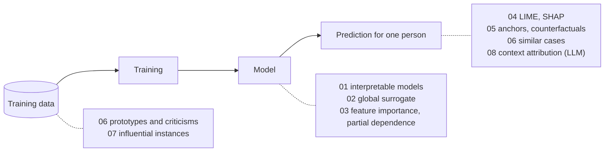

# Explainability and interpretability: runnable examples

Small, runnable Python projects for the lecture *Explainability and Interpretability* of the
course [Machine Learning in Production](https://mlip-cmu.github.io/) (CMU). Each project shows
one group of techniques with a current tool. You can read everything on GitHub without running
it: each folder has a short README with the results, and a notebook that is committed with
its outputs.

## The case study

A court uses a model that predicts whether a defendant is **rearrested within two years**, as
an input to bail and sentencing decisions. This is a high-stakes decision about a person, so
judges, defendants, auditors, and the developers of the model all have questions:

- How does the model decide in general? Is that acceptable?
- Why did *this* defendant get a high risk? What must be different for another result?
- Which training data made the model the way it is?

Projects 01 to 07 use the same [synthetic dataset](recidivism-data/) of 12 000 defendants. No real
person is in it, and **the process that makes the labels is known**. Thus the projects can
compare each explanation with the truth. Two features (`age_at_first_arrest`, `county`) are
correlated with the causes of a rearrest but are no causes; they show where explanations of a
model are not explanations of the world.

Most projects explain the same opaque model (gradient boosting, 150 trees) and the same
person: a 24-year-old unemployed man with five priors and a drug charge, with a predicted risk
of 0.69.

## The projects

| | Project | Question | Lecture section |
|---|---|---|---|
| 01 | [Inherently interpretable models](01-interpretable-models/) | Can a model that you can read be as accurate? Sparse linear models, score cards, small trees, rule lists. | Understanding a model: inherently interpretable models; "Stop explaining black box models …" |
| 02 | [Global surrogate models](02-global-surrogate/) | Can a small tree describe an opaque model? How faithful is it? | Understanding a model: global surrogates |
| 03 | [Feature importance and partial dependence](03-importance-and-pdp/) | On which features does the model rely, and how does the prediction change with a feature? | Understanding a model: feature importance, partial dependence plots |
| 04 | [LIME and SHAP](04-lime-and-shap/) | Which features were most influential for one prediction? | Explaining a prediction: feature influences, local surrogates, Shapley values |
| 05 | [Anchors and counterfactuals](05-counterfactuals/) | Which facts are enough for the prediction? What must change for a different one? | Explaining a prediction: anchors, counterfactual explanations, actionable counterfactuals |
| 06 | [Similar cases, prototypes, criticisms](06-similarity-and-prototypes/) | Which past cases are like this one? Which few people represent the data, and which do not fit? | Explaining a prediction: similarity; understanding the data: prototypes and criticisms |
| 07 | [Influential instances](07-influential-instances/) | Which training rows changed the model most? | Understanding the data: influential instances |
| 08 | [Context attribution for LLM answers](08-context-attribution/) | Which sentences of the context did an LLM answer depend on? | Explaining a prediction: context attribution for RAG |



Three terms that are easy to confuse:

- **Feature importance** (03): how much does the model rely on a feature, across all predictions?
- **Feature influence** (04): how much does one specific prediction rely on a feature?
- **Influential instance** (07): how much does the model rely on one training row?

## Results that are worth a discussion

- The interpretable models are as accurate as the opaque model (01), on the synthetic data
  and on the real COMPAS data.
- A surrogate tree "explains" a model with a feature that the model never saw (02).
- The model relies on a feature that is not a cause; permutation importance and SHAP report
  that faithfully, and a reader can take it for a fact about the world (03, 04).
- Of 19 smallest counterfactuals for one person, one is actionable; a library without
  constraints proposes a first arrest at age 72 for a 54-year-old (05).
- Criticisms find all rows with impossible values but no flipped label (06).
- Leave-one-out influence does not find 20 bad rows that have the same error, because they
  hide each other (07).
- The real COMPAS data has a processing error that a table by quarter shows at once: the
  rearrest rate is 36.2%, not 45.1% (06).
- An LLM answers from an unverified sentence in its context and cites a different sentence as
  its source; context attribution finds the right one (08).

## How to run

You need [uv](https://docs.astral.sh/uv/). Each folder is a separate uv project with its own
locked dependencies; the first run installs them.

```sh
cd 05-counterfactuals
uv run jupyter lab anchors_and_counterfactuals.ipynb
```

```sh
./run_all.sh                    # everything (several minutes)
./run_all.sh 04-lime-and-shap   # one folder
```

The notebooks are plain Jupyter notebooks. `./run_all.sh` executes them and writes the outputs
into the files.
